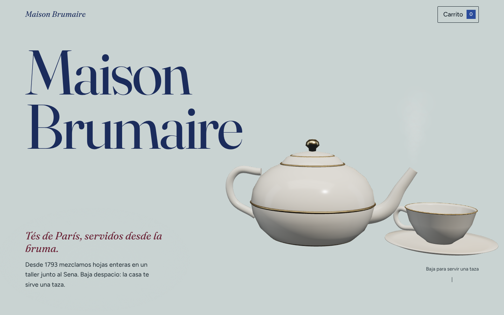
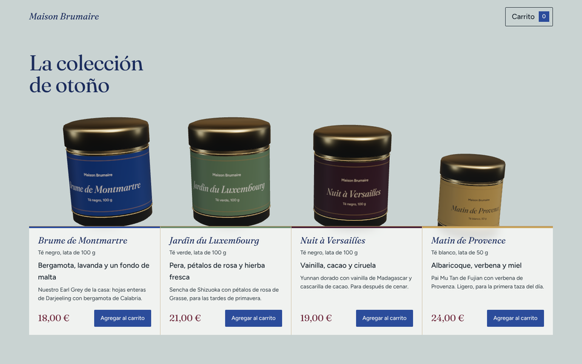
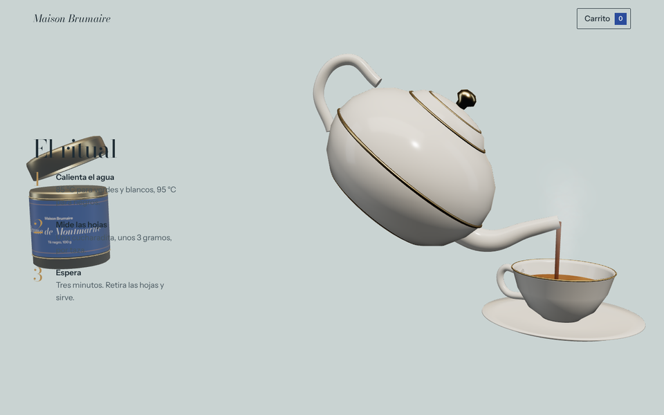

# Maison Brumaire

Tienda ficticia de tés franceses contada con una escena 3D que avanza con el scroll. La tetera humea en la bruma, la lata se abre y suelta las hojas, la colección surge de la niebla y, al final, la tetera sirve una taza.

**Sitio:** https://mateomerino14.github.io/MAISON-BRUMAIRE/

> Proyecto de portafolio. La marca, los productos y los precios son inventados; el carrito es de demostración y no procesa pagos.



| La colección | El ritual |
|---|---|
|  |  |

## Stack

| Parte | Herramienta |
|---|---|
| Sitio | Vite, React 19 y TypeScript estricto |
| 3D | Three.js con React Three Fiber y drei |
| Scroll suave | Lenis |
| Modelos | Scripts de Blender en Python (`tools/blender/`) que exportan `.glb` |
| Pruebas | Vitest y Testing Library |
| Calidad | oxlint, TypeScript, knip (código muerto) y Ruff para los scripts |
| Publicación | GitHub Actions y GitHub Pages |

## Cómo funciona

1. **Paradas.** Cada sección de la página mide lo mismo y lleva `data-stop`. `useSmoothScroll` convierte la posición del scroll en un progreso medido en paradas: vale `0` en la portada, `1` en la tetera, y así hasta `6` en el cierre.
2. **Cámara.** `src/scroll/keyframes.ts` guarda una pose de cámara por parada. `sampleCamera` interpola entre las dos más cercanas con una curva suave, y `CameraRig` la aplica en cada cuadro con un leve paralaje que sigue al puntero.
3. **Animaciones.** `src/scene/timeline.ts` define en qué tramo del recorrido pasa cada cosa: la lata protagonista surge de la bruma y abre la tapa, las hojas vuelan en espiral, la colección emerge lata por lata, la tetera sirve y la taza se llena. Son funciones puras del progreso: al subir el scroll todo se rebobina solo.
4. **Sin renders de más.** El progreso vive en un objeto fuera de React; la escena lo lee dentro de `useFrame`, así que el scroll no vuelve a renderizar componentes.
5. **Celular.** Cada parada guarda también el centro de su objeto (`focus`) y su propio acercamiento (`narrowZoom`). En un celular la cámara apunta a ese centro y ajusta la distancia para que el objeto llene el ancho de la pantalla, con los textos abajo. Entre parada y parada, los textos se desvanecen con animaciones ligadas al scroll (`animation-timeline: view()`), así nunca cruzan por encima de la escena.
6. **Etiquetas.** Las etiquetas de las latas se dibujan en un `canvas` con el color y el nombre de cada té, y se repintan cuando terminan de cargar las fuentes.

## Diseño

La idea central es la bruma: el fondo de la página y la niebla de la escena comparten el mismo color, así los objetos aparecen y desaparecen en ella.

| Rol | Color | Contraste sobre la bruma |
|---|---|---|
| Bruma (fondo y niebla) | `#C9D3D2` | — |
| Títulos | Azul noche `#1B2C5C` | 8.8:1 |
| Párrafos | `#2A363D` | 8.1:1 |
| Frases destacadas y precios | Burdeos `#6A2236` | 7.3:1 |
| Números del ritual | Oro oscuro `#76561F` | 4.4:1 (solo en tamaños grandes) |
| Botones | Azul de Sèvres `#2B4C9B` | 5.3:1 |
| Papel de la nota de pedido | `#FBFAF5` | — |
| Sello de lacre | Burdeos `#6A2236` con texto `#E9D9C0` | 8.0:1 |
| Filetes y líneas | Oro `#B08D57` | decorativo |

- **Tipografía:** Fraunces para títulos (serif de óptica variable) y Figtree para el texto, a 18 px.
- **Velo de bruma:** un degradado suave detrás de cada bloque de texto evita que las hojas y los objetos lo ensucien.
- **Carrito como nota de pedido:** el panel es una nota de pedido en papel pautado que entra ladeado. Cada renglón se escribe de izquierda a derecha con puntos guía hasta el precio, y el pedido se confirma tocando un sello de lacre que estampa *Pedido confirmado*. El envío cuesta 4,90 € y es gratis desde 50 € (valores de la demostración).

## Estructura

```
src/
├── content/      Textos de la marca y catálogo de tés
├── scroll/       Progreso del scroll, scroll suave y poses de la cámara
├── scene/        Escena 3D: tetera, taza, latas, hojas, vapor y línea de tiempo
├── shop/         Carrito (funciones puras + contexto) y formato de precios
├── ui/           Secciones HTML, encabezado y panel del carrito
└── styles/       Estilos globales
tools/blender/    Modelado procedural de las piezas
public/models/    Modelos .glb exportados
```

## Desarrollo

```bash
npm install
npm run dev        # servidor local
npm run lint       # oxlint
npm run typecheck  # TypeScript
npm test           # Vitest
npm run build      # compilación para GitHub Pages
npx knip           # exportaciones, archivos y dependencias sin uso
```

### Regenerar los modelos

Los `.glb` salen de `tools/blender/models.py`; para cambiar una pieza se cambia el script y se vuelve a exportar.

```bash
pip install bpy                       # Blender como módulo de Python
python3 tools/blender/models.py       # o: blender --background --python tools/blender/models.py
```

## Convenciones

Ramas, commits y estilo de código en [reglas.md](reglas.md).
